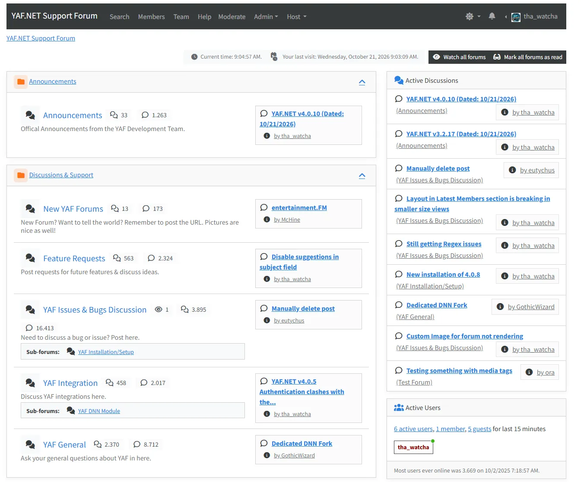
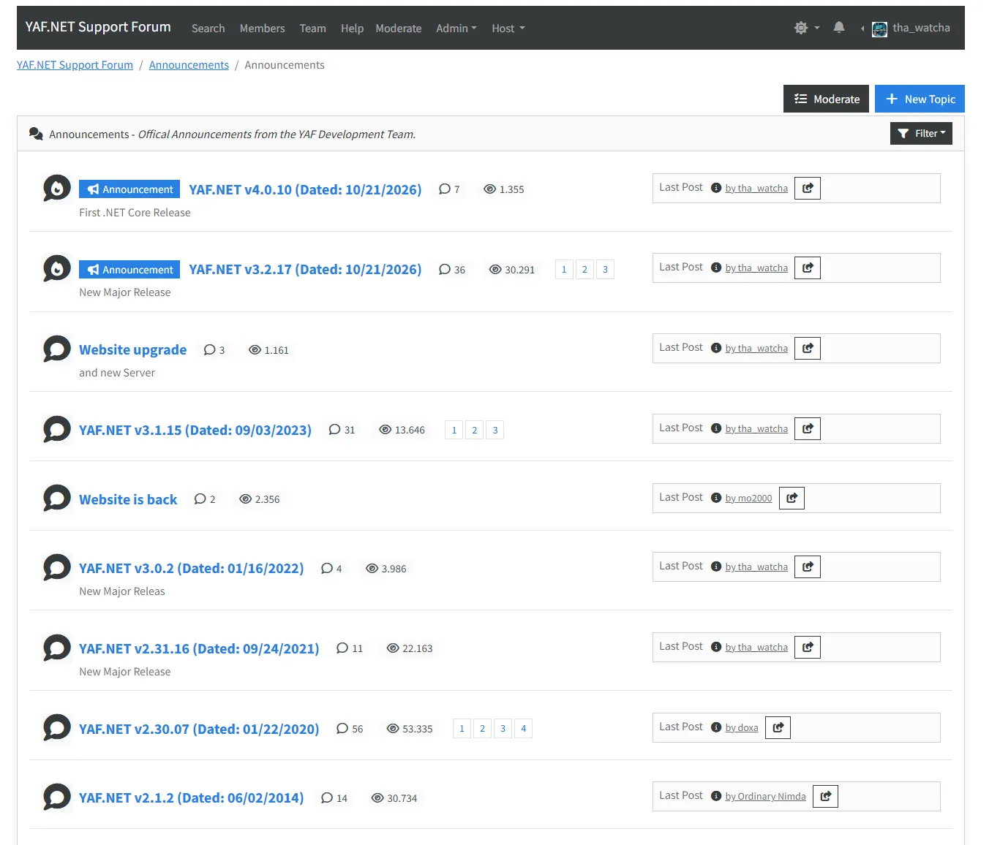
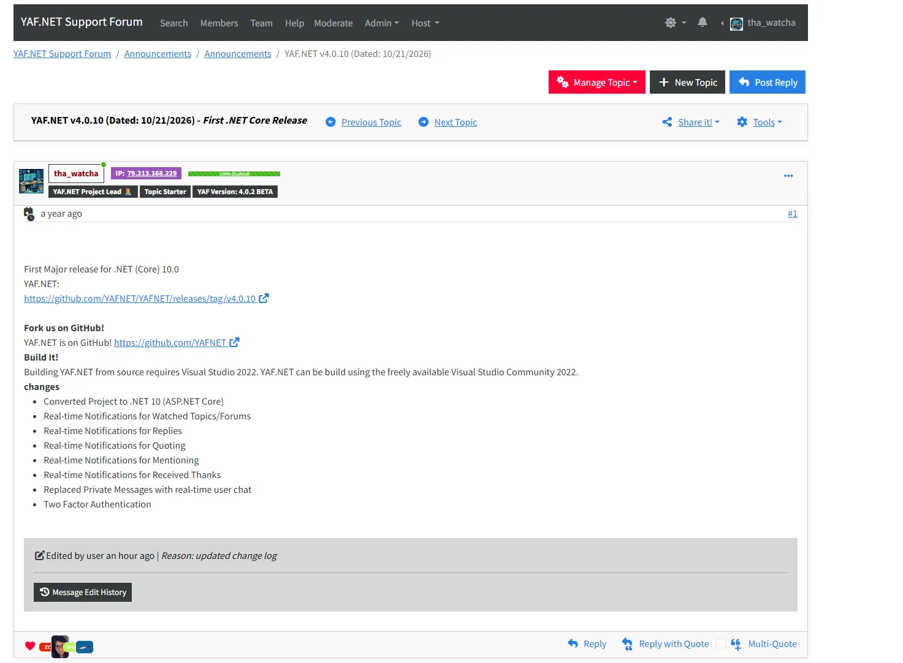
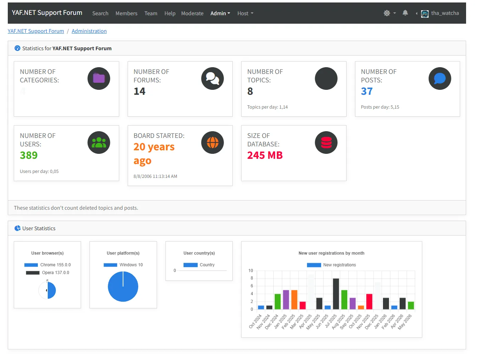

<p align="center">
  
</p>

<p align="center">
  <a href="LICENSE.md"></a>
  <a href="https://github.com/YAFNET/YAFNET/actions/workflows/build.yml"></a>
  <a href="https://github.com/YAFNET/YAFNET/actions/workflows/build-netfx.yml"></a>
  <a href="https://github.com/YAFNET/YAFNET/actions/workflows/build.yml"></a>
  <a href="https://github.com/YAFNET/YAFNET/actions/workflows/build-netfx.yml"></a>
  <a href="https://hub.docker.com/r/yafnet/yafnet"></a>
</p>

**YetAnotherForum.NET** (YAF.NET) is an open source forum for ASP.NET. The project is an international collaboration of like-minded, skilled and creative people who strive to make YAF.NET the most robust and flexible forum solution available.

See a live YAF.NET forum in action at the [community support forum](https://yetanotherforum.net/Forums).

## Contents

- [Versions](#versions)
- [Quick start with Docker](#quick-start-with-docker)
- [Installation & upgrade](#installation--upgrade)
- [Building from source](#building-from-source)
- [Screenshots](#screenshots)
- [Support](#support)
- [Security](#security)
- [License](#license)

## Versions

| Version   | Platform                       | Branch                                                 | Status         |
|-----------|--------------------------------|--------------------------------------------------------|----------------|
| YAF 4.x   | ASP.NET Core / .NET 10.0       | [`master`](https://github.com/YAFNET/YAFNET)           | Stable         |
| YAF 3.2.x | ASP.NET / .NET Framework 4.8.1 | [`netfx`](https://github.com/YAFNET/YAFNET/tree/netfx) | Stable         |

YAF 4.x supports the following databases:

- Microsoft SQL Server
- MySQL / MariaDB
- PostgreSQL
- SQLite

YAF 3.x is also available as a **DNN module**, see the [YAFNET-DNN project](https://github.com/YAFNET/YAFNET-DNN).

Release notes are in [CHANGES.md](CHANGES.md).

## Quick start with Docker

Prebuilt images are published on Docker Hub as [`yafnet/yafnet`](https://hub.docker.com/r/yafnet/yafnet), with a Docker Compose file for each database provider. From the `yafsrc` folder:

```bash
docker compose -f docker-compose-SqlServer.yml up -d
```

Then open <http://localhost:8001>. On the first start you are taken to the installation wizard, which creates the database tables and the admin account.

> [!IMPORTANT]
> Change the default database password `MyPass@word` in the compose file before starting the stack.

Compose files for MySQL, PostgreSQL and SQLite, configuration via environment variables, mail setup and data volumes are described in the [Docker guide](https://github.com/YAFNET/YAFNET/wiki/Docker).

## Installation & upgrade

- [New installation](https://github.com/YAFNET/YAFNET/wiki#getting-started) (IIS, Linux with nginx, Docker)
- [Upgrade from YAF.NET 3.x or older](https://github.com/YAFNET/YAFNET/wiki/Upgrade-to-YAF-v4)
- [Troubleshooting](https://github.com/YAFNET/YAFNET/wiki/Troubleshooting)

More documentation can be found in the [GitHub wiki](https://github.com/YAFNET/YAFNET/wiki).

## Building from source

Prerequisites: the [.NET 10.0 SDK](https://dotnet.microsoft.com/download) and [Node.js](https://nodejs.org/).

```bash
cd yafsrc/YetAnotherForum.NET
npm install
npm run build                           # compile the JS and CSS files (Grunt)

cd ..
dotnet build YAF.NET-SqlServer.slnx     # or YAF.NET-MySql / -PostgreSQL / -Sqlite
```

See the wiki for the full instructions: [command line](https://github.com/YAFNET/YAFNET/wiki/Build-with-Command-Line) and [Visual Studio](https://github.com/YAFNET/YAFNET/wiki/Build-with-Visual-Studio). How to run the unit and UI tests is described in the [tests README](yafsrc/Tests/README.md).

## Screenshots

**Board index**



**Forum**



**Topic**



**Admin control panel**



## Support

- Ask questions and get help from the community at the [YAF.NET support forum](https://yetanotherforum.net/Forums).
- Report bugs and request features in the [issue tracker](https://github.com/YAFNET/YAFNET/issues).
- Read the [wiki](https://github.com/YAFNET/YAFNET/wiki) for documentation.

## Security

Please do **not** report security vulnerabilities in public issues. See [SECURITY.md](SECURITY.md) for how to report them.

## License

YAF.NET is licensed under the [Apache License 2.0](LICENSE.md).
