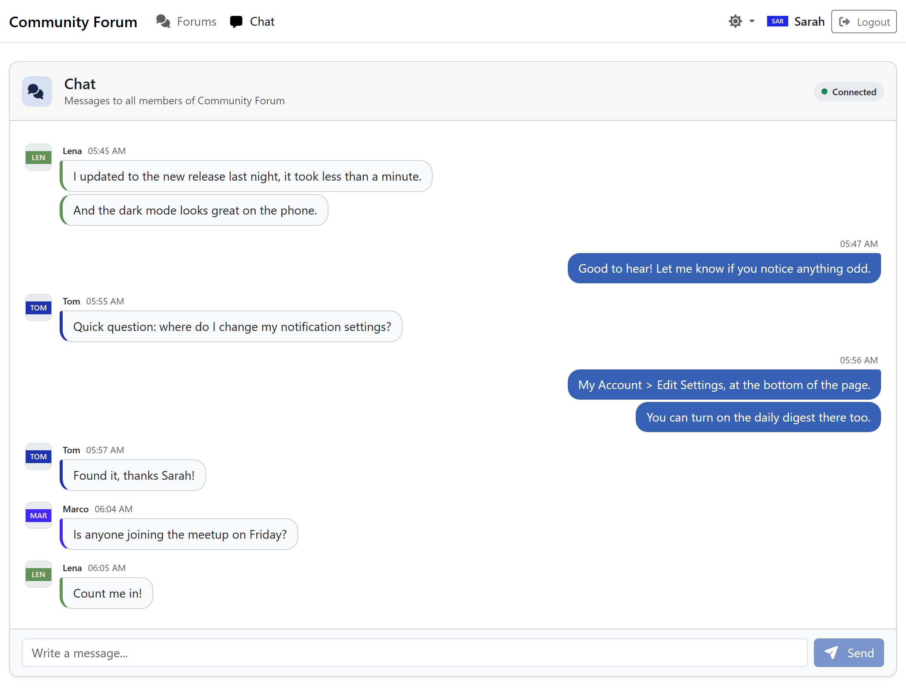

[](https://nuget.org/packages/YAFNET.UI.Chat)
[](https://ko-fi.com/w8tcha)

A real-time chat room for [YAF.NET](https://yetanotherforum.net): all members of the forum can write to each other on one page (`/Chat`). The messages are sent with SignalR and saved in the forum database.



- Members only: guests are sent to the login page, suspended members can read but not write
- Shows the latest 100 messages, new messages appear right away for everybody
- Messages of the same member within a few minutes are grouped, the times are shown in the time zone of the reader
- Uses the theme of the forum, including light and dark mode

## Prerequisites

* YAF.NET v4 with the [YAFNET.RazorPages](https://www.nuget.org/packages/YAFNET.RazorPages/) package, integrated in an ASP.NET Core application as the `Forums` area (see [Integrate YAF.NET into an existing ASP.NET Core application](https://github.com/YAFNET/YAFNET/wiki/YAF.NET-Integration-in-to-an-existing-ASP.NET-Core-Application))

## Usage

1. Install the [YAFNET.UI.Chat](https://www.nuget.org/packages/YAFNET.UI.Chat/) package

   ```cmd
   dotnet add package YAFNET.UI.Chat
   ```

2. Map the chat hub in `Program.cs`, next to the hubs of the forum

   ```csharp
   using YAF.UI.Chat;

   ...

   app.MapYafHubs();

   app.MapHub<AllChatHub>("/AllChatHub");
   ```

3. Link to the chat, e.g. in your `_Layout.cshtml`

   ```html
   <a class="nav-link" asp-area="Chat" asp-page="/Index">Chat</a>
   ```

The chat page comes with a simple layout (name of the board, links to the forum and the chat, light/dark mode, login). To show it in the layout of your site, add your own `Areas/Chat/Pages/Shared/_Layout.cshtml` (the [YAF.NET Sample Application](https://github.com/YAFNET/YAF.SampleWebApplication) does this). Your layout needs the theme css of the forum, `~/css/forum.min.css` (icons) and a `Scripts` section; the chat page brings its own styles and script.

## Community Support Forum

See a real live YAF Forum by visiting the YetAnotherForum.NET community support forum: https://forum.yetanotherforum.net/. Also, get your questions answered by the YAF community.

## License

Yet Another Forum.NET is licensed under the Apache 2.0 license.
